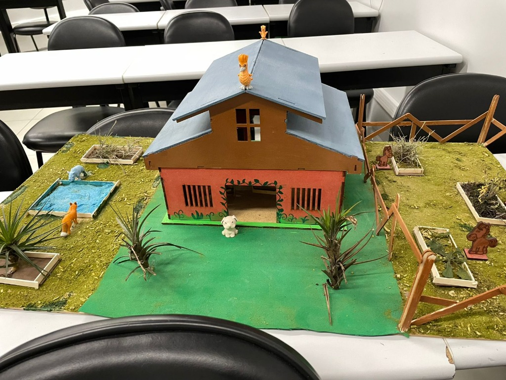
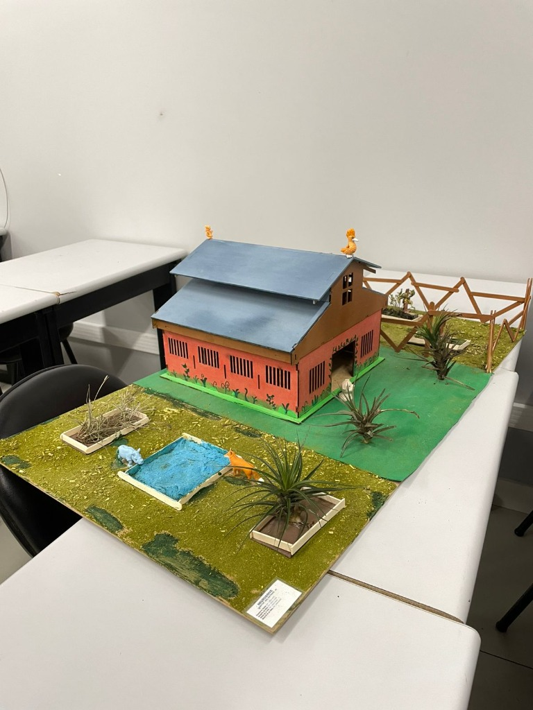
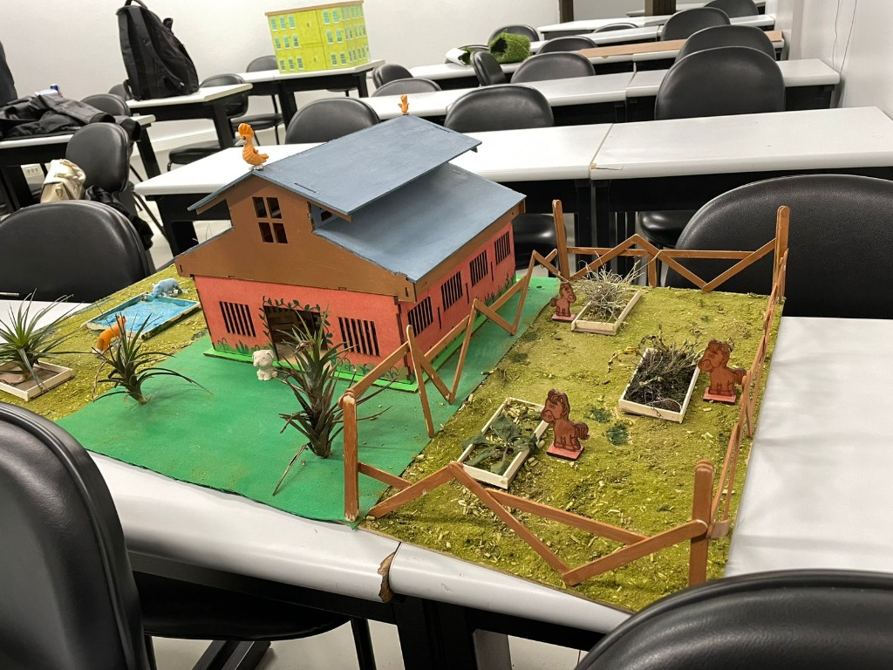
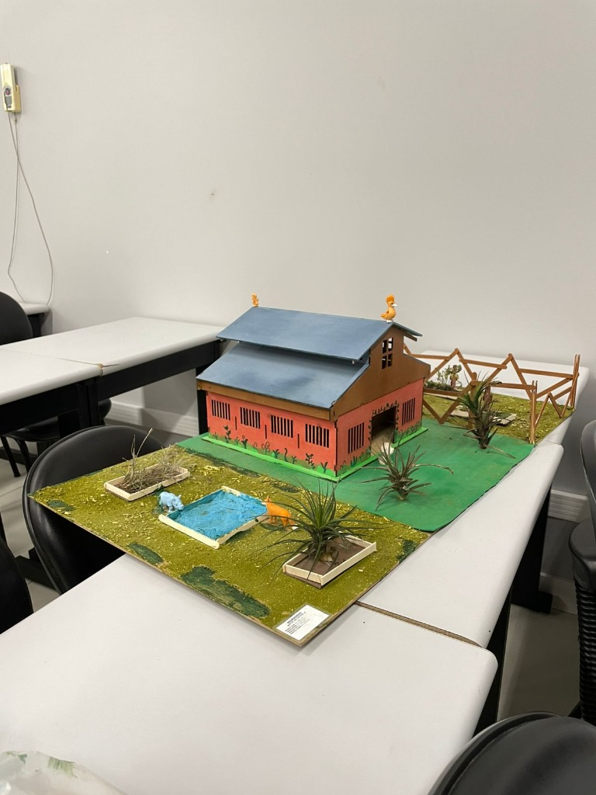
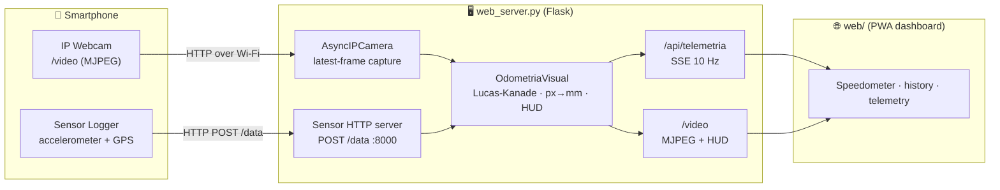
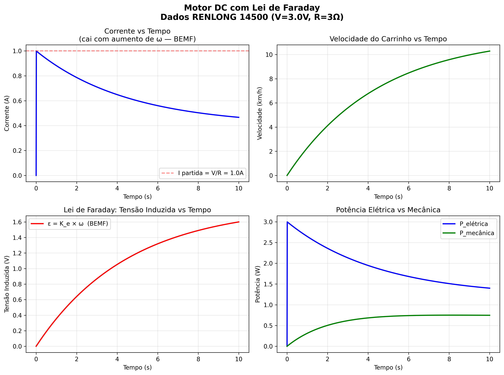
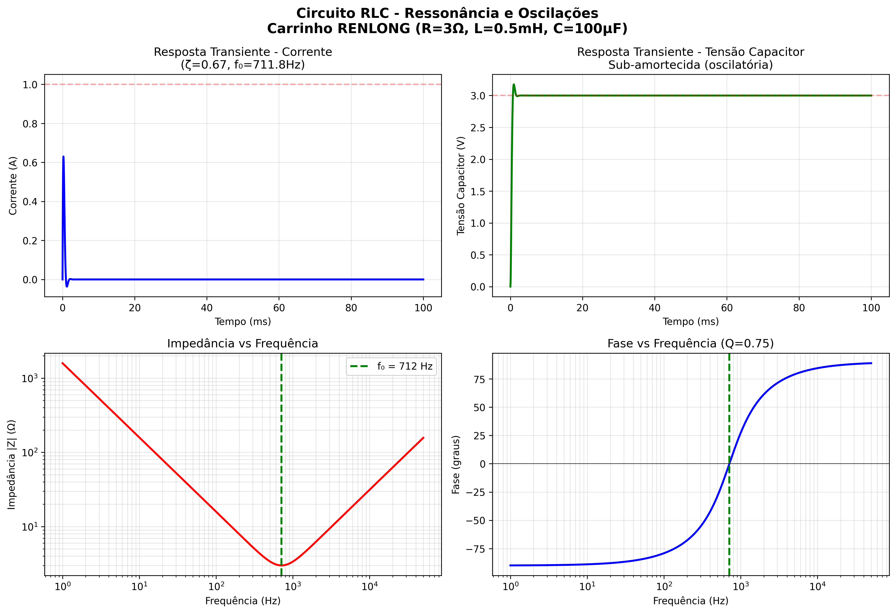
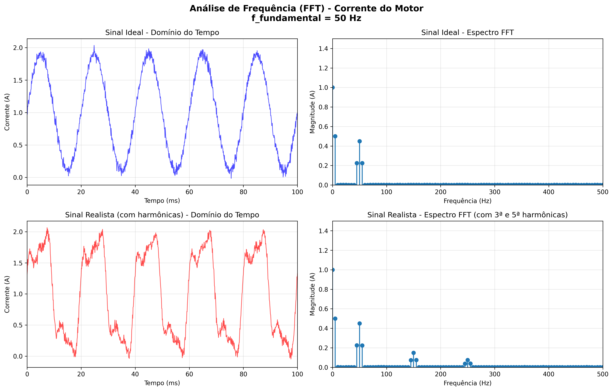
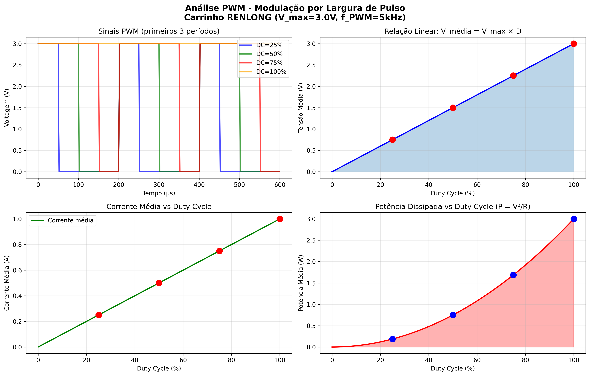
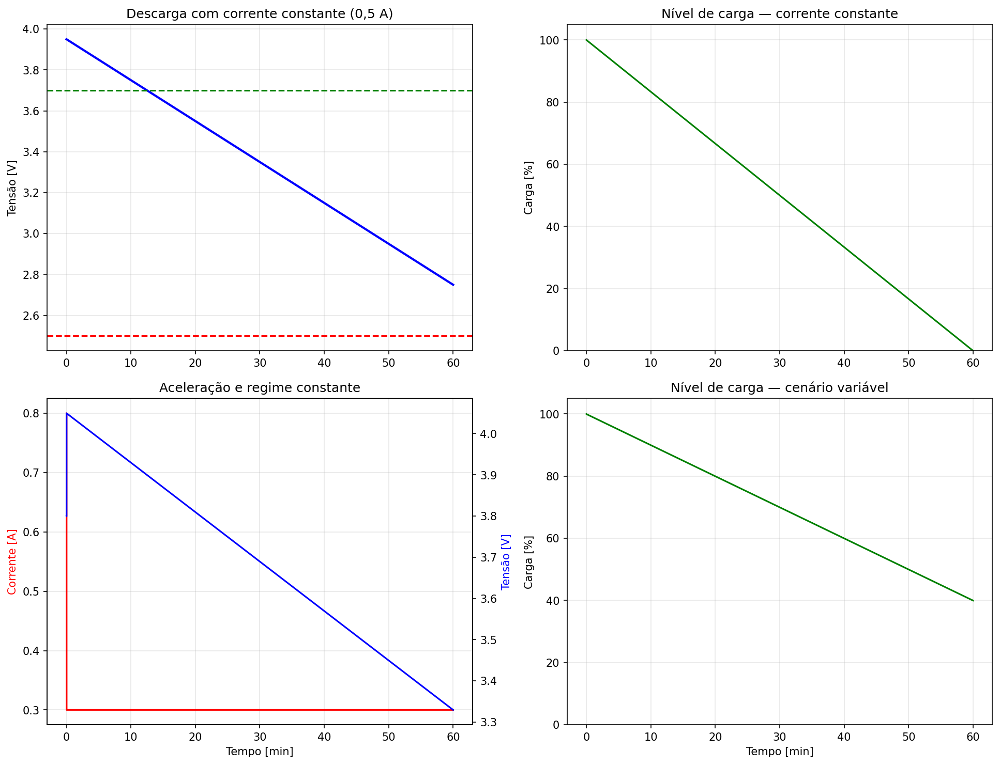

<div align="center">

# ⬡ NeuroDrive

### Real-time visual odometry and telemetry for a 1:24 scale model, powered by Lucas-Kanade optical flow

🥉 **3rd place — A Jornada UniRitter 2026** · Honor certificate


[](https://github.com/eduardo-a-xavier/neurodrive/actions/workflows/tests.yml)

[Português (BR)](README.pt-BR.md) · [Quick start](#-quick-start) · [Architecture](#-architecture) · [API](#-api-reference) · [Contributing](CONTRIBUTING.md)

</div>

---

## 🎯 The problem

A small scale model has no speedometer, no GPS lock indoors and no room for dedicated sensors. NeuroDrive turns **a regular smartphone** into the whole instrument cluster: the phone's camera streams video over Wi-Fi, and a Python server estimates speed and acceleration from the **motion of the floor** in each frame.

In parallel, SciPy simulations model the electrical and magnetic phenomena of the car's DC motor (back-EMF, RLC resonance, FFT harmonics, PWM and battery discharge), which is the physics behind the course this project was built for.

## ✨ Features

- **Visual odometry** with Lucas-Kanade optical flow (`cv2.calcOpticalFlowPyrLK`) over a trapezoidal region of interest.
- **px → mm calibration**, persisted in `calibracao_neurodrive.json`.
- **Five odometry modes:** `real`, `sensor`, `listras`, `demo`, `simulado`.
- **Live dashboard (PWA)** fed by Server-Sent Events at 10 Hz: speed, average, peak, acceleration, history chart.
- **MJPEG stream** with an OpenCV-rendered HUD (speedometer or cyber layout).
- **Smartphone sensor fusion:** accelerometer and GPS speed via [Sensor Logger](https://apps.apple.com/app/sensor-logger/id1531582925).
- **Five physics simulations** (motor, RLC, FFT, PWM, battery) that generate PNG plots.

## 📸 The model

<div align="center">

| Front view | Side perspective |
|:---:|:---:|
|  |  |
| **Right view** | **Left view** |
|  |  |

</div>

## 🏗 Architecture



## 🚀 Quick start

**Requirements:** Python 3.10+ and a smartphone running [IP Webcam](https://play.google.com/store/apps/details?id=com.pas.webcam) (Android) on the same Wi-Fi network as the computer.

```bash
git clone https://github.com/eduardo-a-xavier/neurodrive.git
cd neurodrive

python -m venv .venv
# Windows: .venv\Scripts\activate    |    Linux/macOS: source .venv/bin/activate
pip install -r requirements.txt

# Optional: preset the camera. You can also set it later in the dashboard.
echo "CAMERA_IP=192.168.x.x:8080" > .env

python web_server.py
```

Open `http://localhost:5000` (the terminal also prints the LAN address).

### Configuration

Set these in a `.env` file (ignored by Git) or as environment variables:

| Variable | Default | Description |
|---|---|---|
| `CAMERA_IP` | — | `host:port` of the phone camera; the server reads `http://<CAMERA_IP>/video` |
| `WEB_PORT` | `5000` | Port of the dashboard and API |
| `SENSOR_SERVER_PORT` | `8000` | Port that receives Sensor Logger `POST /data` |

### Run the physics simulations

Each script writes its plots to `web/assets/simulations/`, the same images shown in this README and in the dashboard.

```bash
python motor_simulation_v2_faraday.py   # faraday_motor_response.png
python circuito_rlc.py                  # rlc_resonancia.png
python analise_frequencia.py            # fft_analise_frequencia.png
python pwm_analise.py                   # pwm_analise.png
python analise_bateria.py               # analise_bateria.png
python motor_simulation.py              # simulacao_1_voltagens / _2_atrito / _3_eficiencia
```

### Run the tests

```bash
pip install -r requirements-dev.txt
python -m pytest
```

The same suite runs in CI on every push and pull request ([`tests.yml`](.github/workflows/tests.yml), Python 3.10).

> **Security note:** the server is designed for a trusted local network. The camera set from the dashboard must be a private LAN IPv4 address (`10.0.0.0/8`, `172.16.0.0/12` or `192.168.0.0/16`).

## 🔌 API reference

Base URL: `http://localhost:5000`

| Method | Route | Purpose |
|---|---|---|
| `GET` | `/` | Dashboard (PWA) |
| `GET` | `/video` | MJPEG stream with HUD (`multipart/x-mixed-replace`) |
| `GET` | `/api/telemetria` | Telemetry as Server-Sent Events, 10 Hz |
| `GET` | `/api/galeria` | JSON list of images in `web/assets/gallery` |
| `POST` | `/api/config_camera` | Change the camera source at runtime |
| `POST` | `/api/tecla` | Send a HUD shortcut key remotely |

### `GET /api/telemetria`

```bash
curl -N http://localhost:5000/api/telemetria
```

Each event is a JSON line prefixed by `data: `:

```json
{
  "vel_inst": 0.0,
  "vel_media": 0.0,
  "vel_max": 0.0,
  "acel": 0.0,
  "modo": "real",
  "qualidade": 0,
  "sensor_ativo": false,
  "gps_kmh": null,
  "accel_x": null,
  "accel_y": null,
  "historico": []
}
```

> Values above are placeholders showing the shape. Speeds are in km/h, acceleration in m/s². `gps_kmh`, `accel_x` and `accel_y` are `null` unless Sensor Logger sent data in the last 2 seconds.

### `POST /api/config_camera`

```bash
curl -X POST http://localhost:5000/api/config_camera \
  -H "Content-Type: application/json" \
  -d '{"url": "192.168.1.20:8080"}'
```

```json
{ "status": "ok", "url": "http://192.168.1.20:8080/video" }
```

A missing `http://` prefix and `/video` path are added automatically, and a trailing `/data` becomes `/video`. The host must be a private LAN IPv4 address; credentials in the URL are rejected.

Errors return `400`. Without a `url` field: `{"error": "invalid"}`. With a rejected URL, `error` carries the reason (the messages are in Portuguese), for example:

```bash
curl -X POST http://localhost:5000/api/config_camera \
  -H "Content-Type: application/json" \
  -d '{"url": "8.8.8.8"}'
# {"error": "a câmera deve usar um endereço IPv4 privado da LAN"}
```

### `POST /api/tecla`

```bash
curl -X POST http://localhost:5000/api/tecla \
  -H "Content-Type: application/json" \
  -d '{"tecla": "c"}'
```

Returns `{"status": "ok"}`. The key must be a single character.

| Key | Action |
|---|---|
| `C` | Start / finish px→mm calibration |
| `S` | Cycle odometry mode |
| `L` | Toggle HUD layout (speedometer / cyber) |
| `I` | Toggle the optical-flow engine |
| `R` | Reset statistics |
| `Q` | Quit (OpenCV window) |

### Sensor Logger ingest

Point Sensor Logger's HTTP push to `http://<computer-ip>:8000/data`. The accelerometer and `location` (GPS speed) payloads feed the `sensor` mode.

## 🧠 How the vision pipeline works

`neurodrive_pipeline.py` → class `OdometriaVisual`

1. Downscale the frame by 50% to cut per-frame cost.
2. Mask a trapezoidal region of interest that matches the track perspective.
3. Track features with pyramidal Lucas-Kanade optical flow (`winSize=(15, 15)`, `maxLevel=2`).
4. Take the **median** displacement (robust to outliers) and convert it with the px→mm calibration.
5. Derive speed in km/h, applying the model scale factor (1:24), then acceleration and statistics.

| Mode | Data source |
|---|---|
| `real` | Calibrated optical flow (px → mm) |
| `sensor` | Smartphone accelerometer + GPS |
| `listras` | Floor-stripe detection (HSV) |
| `demo` | Automatic simulation |
| `simulado` | Uncalibrated, flow-proportional |

## ⚡ Physics simulations

| Script | Phenomenon | Output |
|---|---|---|
| `motor_simulation_v2_faraday.py` | Faraday's law and back-EMF of the DC motor (`scipy.integrate.odeint`) |  |
| `circuito_rlc.py` | Series RLC resonance and damping (f₀ = 1/(2π√LC) ≈ 712 Hz for L = 0.5 mH, C = 100 µF) |  |
| `analise_frequencia.py` | FFT, Hanning window, THD, 3rd/5th harmonics |  |
| `pwm_analise.py` | PWM power control |  |
| `analise_bateria.py` | LiPo 3.7 V / 500 mAh discharge curve |  |

Motor model:

```text
V_in = I·R + L·dI/dt + ε        ε = K_e·ω   (back-EMF, Faraday)
τ = K_t·I                       J·dω/dt = τ − b·ω
```

With the motor stalled (ω = 0) the peak current is `V/R = 3.0 V / 3 Ω = 1.0 A`; it drops as back-EMF grows.

## 🛠 Tech stack

| Area | Tools |
|---|---|
| Computer vision | OpenCV, NumPy |
| Backend | Python, Flask, Server-Sent Events |
| Scientific computing | SciPy, Matplotlib |
| Frontend | Vanilla JS, PWA (manifest + service worker) |
| Configuration | python-dotenv |

## 📁 Project structure

```text
neurodrive/
├── web_server.py                  # Flask app: stream, SSE, REST
├── neurodrive_pipeline.py         # OdometriaVisual, AsyncIPCamera, sensor server
├── motor_simulation_v2_faraday.py # Back-EMF simulation
├── circuito_rlc.py                # RLC resonance
├── analise_frequencia.py          # FFT / THD
├── pwm_analise.py                 # PWM
├── analise_bateria.py             # Battery discharge
├── motor_simulation.py            # Motor voltage / friction / efficiency plots
├── calibracao_neurodrive.json     # Persisted px→mm calibration
├── requirements.txt               # Runtime dependencies
├── requirements-dev.txt           # Test dependencies
├── tests/                         # pytest suite
├── .github/workflows/tests.yml    # CI
└── web/                           # PWA dashboard and assets
```

## 🎓 Academic context

Built for assessment A3 of *Electrical, Magnetic and Oscillatory Phenomena* (Software Engineering, UniRitter, 2026/1).

| Topic | Where it shows up |
|---|---|
| Differential calculus / ODEs | `odeint` for back-EMF and the RLC circuit |
| Linear algebra | Frame-to-frame optical-flow transforms |
| Electromagnetism / Faraday | DC motor back-EMF model |
| Oscillatory phenomena | RLC resonance |
| Complex numbers / Fourier | FFT with Hanning window, THD |
| PWM / electrodynamics | Motor power control |

## 🤝 Contributing

See [CONTRIBUTING.md](CONTRIBUTING.md). Issues and pull requests are welcome.

## 📄 License

[MIT](LICENSE) © 2026 eduardo-a-xavier
