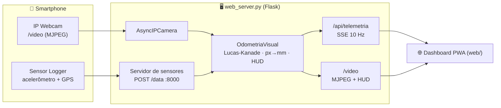
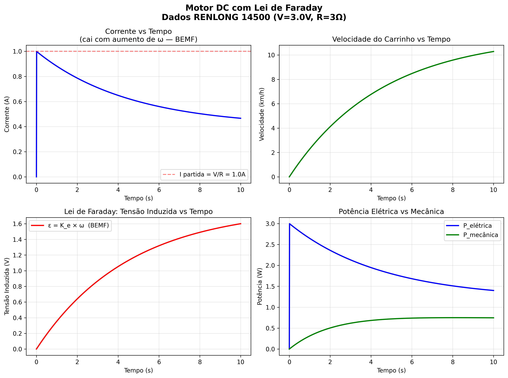
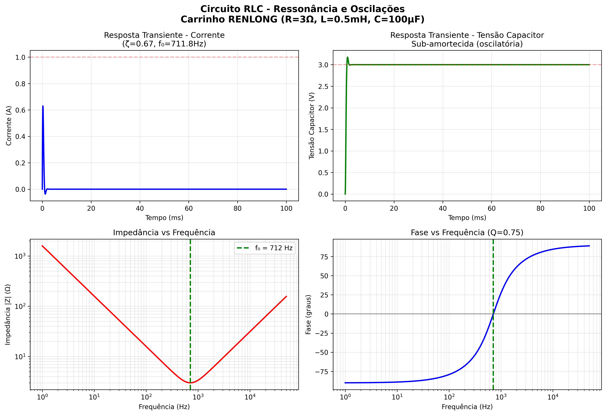
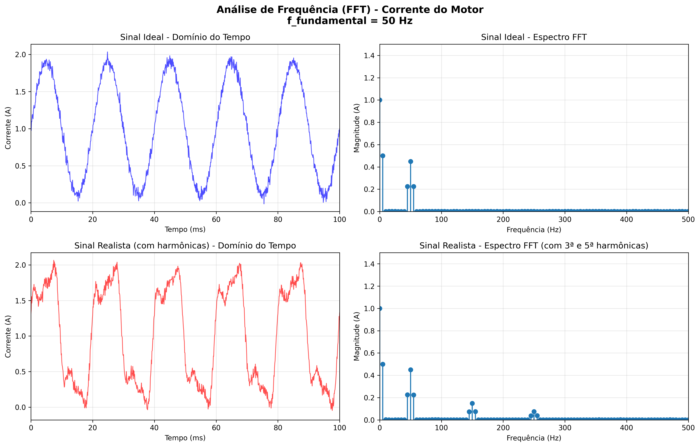

<div align="center">

# ⬡ NeuroDrive

### Odometria visual e telemetria em tempo real para uma maquete 1:24, com Optical Flow (Lucas-Kanade)

🥉 **3º lugar — A Jornada UniRitter 2026** · Certificado de Honra ao Mérito


[English](README.md) · [Início rápido](#-início-rápido) · [Arquitetura](#-arquitetura) · [API](#-api)

</div>

---

## 🎯 O problema

Uma maquete em escala pequena não tem velocímetro, nem GPS em ambiente fechado, nem espaço para sensores dedicados. O NeuroDrive transforma **um smartphone comum** em todo o painel: a câmera transmite vídeo por Wi-Fi e um servidor Python estima velocidade e aceleração pelo **movimento do piso** em cada frame.

Em paralelo, simulações em SciPy modelam os fenômenos elétricos e magnéticos do motor DC do carrinho (força contra-eletromotriz, ressonância RLC, harmônicas por FFT, PWM e descarga da bateria).

## 🏗 Arquitetura



## 🚀 Início rápido

**Requisitos:** Python 3.10+ e um smartphone com [IP Webcam](https://play.google.com/store/apps/details?id=com.pas.webcam) na mesma rede Wi-Fi.

```bash
git clone https://github.com/eduardo-a-xavier/neurodrive.git
cd neurodrive

python -m venv .venv
# Windows: .venv\Scripts\activate    |    Linux/macOS: source .venv/bin/activate
pip install -r requirements.txt

# Opcional: pré-configura a câmera (também dá para definir pelo dashboard)
echo "CAMERA_IP=192.168.x.x:8080" > .env

python web_server.py
```

Acesse `http://localhost:5000`.

| Variável | Padrão | Descrição |
|---|---|---|
| `CAMERA_IP` | — | `host:porta` da câmera; o servidor lê `http://<CAMERA_IP>/video` |
| `WEB_PORT` | `5000` | Porta do dashboard e da API |
| `SENSOR_SERVER_PORT` | `8000` | Porta que recebe o `POST /data` do Sensor Logger |

### Simulações físicas

```bash
python motor_simulation_v2_faraday.py
python circuito_rlc.py
python analise_frequencia.py
python pwm_analise.py
python analise_bateria.py
```

Cada script salva seus gráficos em `web/assets/simulations/`.

### Testes

```bash
pip install -r requirements-dev.txt
python -m pytest
```

O servidor foi pensado para rede local confiável: a câmera definida pelo dashboard precisa ser um IPv4 privado da LAN.

## 🔌 API

| Método | Rota | Função |
|---|---|---|
| `GET` | `/` | Dashboard |
| `GET` | `/video` | Stream MJPEG com HUD |
| `GET` | `/api/telemetria` | Telemetria via SSE a 10 Hz |
| `GET` | `/api/galeria` | Lista de imagens da galeria |
| `POST` | `/api/config_camera` | Troca a fonte da câmera (`{"url": "..."}`) |
| `POST` | `/api/tecla` | Envia atalho do HUD (`{"tecla": "c"}`) |

Detalhes e exemplos de resposta na [versão em inglês](README.md#-api-reference).

| Tecla | Ação |
|---|---|
| `C` | Iniciar/finalizar calibração px→mm |
| `S` | Alternar modo de odometria |
| `L` | Alternar layout do HUD |
| `I` | Ligar/desligar Optical Flow |
| `R` | Resetar estatísticas |
| `Q` | Encerrar (janela OpenCV) |

## ⚡ Simulações

| Script | Fenômeno |
|---|---|
| `motor_simulation_v2_faraday.py` | Lei de Faraday e BEMF do motor DC |
| `circuito_rlc.py` | Ressonância e amortecimento RLC |
| `analise_frequencia.py` | FFT, janela de Hanning, THD |
| `pwm_analise.py` | Controle de potência por PWM |
| `analise_bateria.py` | Curva de descarga LiPo 3,7 V / 500 mAh |





## 🎓 Contexto acadêmico

Avaliação A3 de *Fenômenos Elétricos, Magnéticos e Oscilatórios* — Engenharia de Software, UniRitter, 2026/1.

## 📄 Licença

[MIT](LICENSE) © 2026 eduardo-a-xavier
